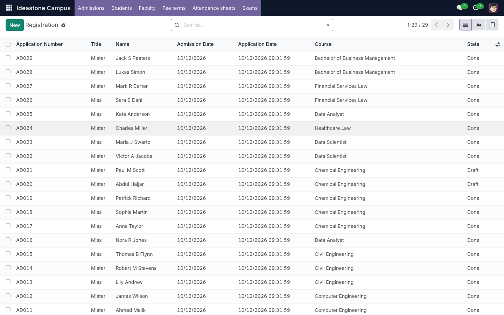
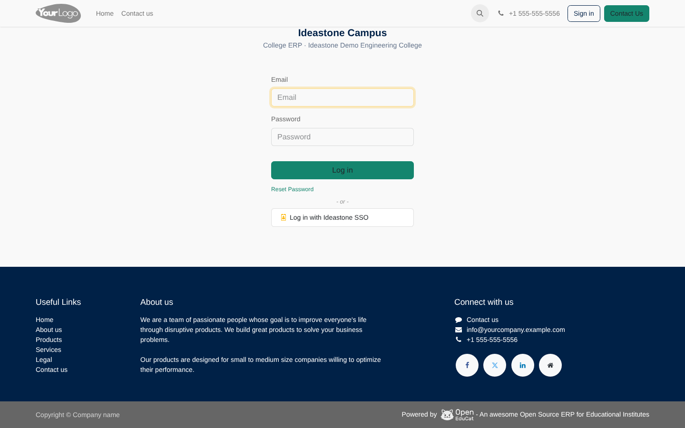
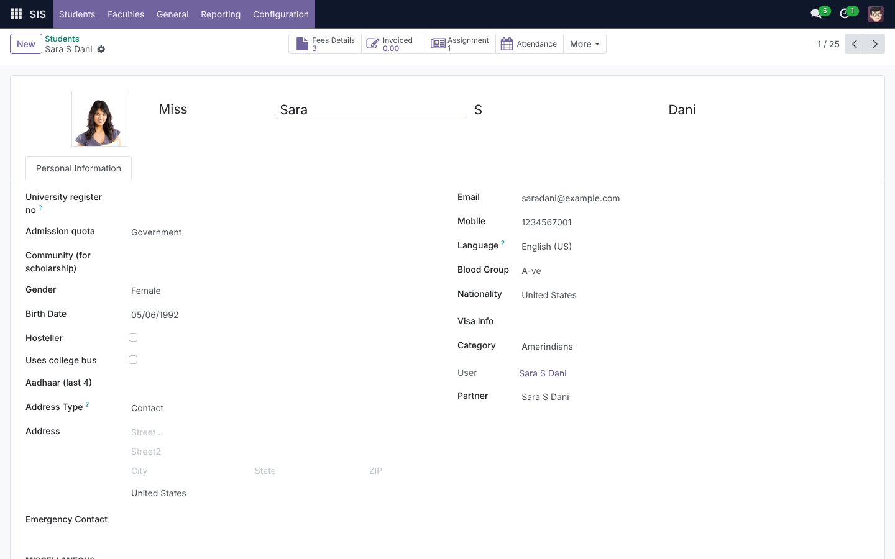
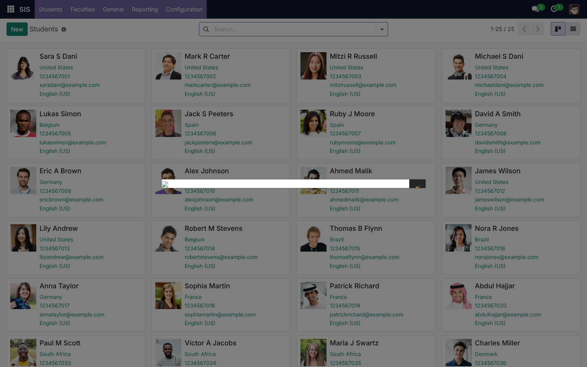

# Ideastone Campus

[](https://github.com/amalnathkp13-boop/ideastone-campus/actions/workflows/ci.yml)


**One platform for the whole college — admissions to alumni, classroom to online learning, with a single login.**

Ideastone Campus is a unified college ERP + LMS for Indian engineering and arts colleges, built by **Ideastone Technologies Pvt Ltd** on proven open-source foundations and extended with everything an Indian college office needs: register numbers, admission quotas, community categories, Anna University-style programmes and semesters, affiliation/AICTE/NAAC details on every receipt and marksheet.



## What's inside

| Area | What you get |
|---|---|
| **Admissions** | Application register, document verification, counselling, offers, one-click conversion to student |
| **Students & faculty** | Complete records, guardians, documents, subjects, workload, HR link |
| **Fees** | Fee terms per programme/quota, invoices, receipts, payment tracking, GST-ready invoicing (Odoo Accounting) |
| **Academics** | Timetable, attendance sheets and reports, internal/model/semester exams, marks, results |
| **Library & more** | Library catalogue and circulation, activities, facilities, classrooms, parents portal |
| **Learning (LMS)** | Course content, SCORM, question banks, online tests, forums, e-portfolios — opens *inside* the ERP |
| **Single sign-on** | One username/password for ERP and LMS (OpenID Connect); can federate the college's existing Active Directory |
| **Campus home** | One launcher screen with a tile per module and live student/faculty/programme counts |
| **AI Pack** (add-on) | **Student Success Radar**: an explainable early-warning score per student with the reason and a suggested action, plus guidance in the student and parent portals, no external service needed. **Campus Assistant**: plain-English questions over live college figures, notice drafting and feedback themes with any OpenAI-compatible provider, including an on-campus Ollama. See [docs/ai-pack.md](docs/ai-pack.md) |

### How the pieces fit

| Layer | Component | Licence | Role |
|---|---|---|---|
| ERP | [Odoo 17 Community](https://github.com/odoo/odoo) + [OpenEduCat 17.0](https://github.com/openeducat/openeducat_erp) | LGPL-3 | Admissions, students, faculty, fees, timetable, attendance, exams, library, parents, accounting, HR |
| LMS | [OpenOlat 21](https://www.openolat.com) | Apache-2.0 | Content, assessments, SCORM, forums |
| SSO | [Keycloak 26](https://www.keycloak.org) | Apache-2.0 | One login (OIDC) for both |
| Ideastone | `addons/ideastone_campus`, `addons/ideastone_lms` | © Ideastone | Branding, Indian-college data model, SSO wiring, embedded LMS, user provisioning |

**One address.** nginx serves everything from a single domain: `/` is the ERP, `/lms/` the LMS, `/sso/` the identity server. Users never see three systems.

```
                 ┌──────────────────────┐
   browser ────► │  nginx (one domain)  │
                 └──┬─────────┬───────┬─┘
                  /          /lms/   /sso/
                    ▼         ▼       ▼
          ┌──────────────┐ ┌────────────┐ ┌──────────┐
          │ Odoo 17      │ │ OpenOlat   │ │ Keycloak │
          │ + OpenEduCat │ │            │ │          │
          │ + Ideastone  │ │            │ │          │
          └──────┬───────┘ └─────┬──────┘ └────┬─────┘
                 └───────── PostgreSQL 16 ──────┘
```

Details: [docs/architecture.md](docs/architecture.md) · [docs/sso.md](docs/sso.md)

## Quick start (Docker)

Requirements: Docker 24+ with Compose, 8 GB RAM, ~10 GB disk.

```bash
git clone --recurse-submodules https://github.com/amalnathkp13-boop/ideastone-campus.git
cd ideastone-campus
cp .env.example .env            # change passwords for anything beyond a local demo
docker compose up -d --build    # first start takes ~5–10 min (downloads images, installs OpenEduCat + demo data)
docker compose logs -f odoo     # watch the install; "campus: install complete" means ready
```

| What | URL | Login |
|---|---|---|
| **Ideastone Campus** | http://localhost | `admin` / `admin` — or **Log in with Ideastone SSO** → `demo.admin` / `demo1234` |
| Learning (OpenOlat) | inside the ERP under **Learning**, or http://localhost/lms/ | SSO, or `administrator` / `openolat` (change on first login) |
| Identity server (Keycloak console) | http://localhost/sso/admin/ | `admin` / `admin` |

`ODOO_DEMO=true` (default) loads demo students, courses and fees so the system is presentable immediately. Set it to `false` in `.env` **before the first start** for a clean production database.

For a real college set `CAMPUS_DOMAIN` and `CAMPUS_PUBLIC_URL` in `.env` to the public hostname (and put TLS in front of nginx).

### First-time setup checklist (after the stack is up)

1. **College identity** — Settings → Companies: name, address, logo, affiliation, approval, NAAC grade, college code.
2. **Departments / programmes / batches** — pre-loaded for a typical Tamil Nadu engineering college; adjust under Ideastone Campus → Settings & master data.
3. **Fee terms** — Ideastone Campus → Fee terms: amounts per programme and quota.
4. **LMS link** — in OpenOlat enable the REST API (Administration → Core functions) and OpenID Connect (Administration → Login) as described in [docs/sso.md](docs/sso.md); then in the ERP go to Ideastone Campus → Settings, enter the API user/key and tick *Create LMS accounts automatically*.
5. **Users** — create staff in Keycloak (or connect the college's LDAP/AD); they sign in to everything with that one account.

### Updating to the latest version

After PRs are merged, every running copy (laptops, demo or college servers) updates with one command:

```bash
./scripts/update.sh        # = git pull + submodule update + docker compose up -d --build
```

On restart Odoo notices the add-on code changed and **upgrades the Ideastone modules automatically** (log line `campus: code changed since last start — upgrading …`). Then hard-refresh the browser (Ctrl+Shift+R). Merging a PR on GitHub alone does not change a running system — it has to pull the new code.

Set `CAMPUS_AUTO_UPGRADE=false` in `.env` to switch the automatic upgrade off (e.g. on production, if upgrades should be done in a maintenance window).

## Running without Docker (development)

Tested on Ubuntu 24.04 / Python 3.12 / PostgreSQL 16:

```bash
git clone --recurse-submodules https://github.com/amalnathkp13-boop/ideastone-campus.git && cd ideastone-campus
git clone --depth 1 -b 17.0 https://github.com/odoo/odoo.git ../odoo
python3.12 -m venv .venv && . .venv/bin/activate
pip install -r ../odoo/requirements.txt psycopg2-binary
cp dev/odoo-dev.conf.example dev/odoo-dev.conf   # edit addons_path / db settings
python ../odoo/odoo-bin -c dev/odoo-dev.conf -d campus -i ideastone_campus,ideastone_lms
```

Then open http://localhost:8069 (`admin` / `admin`). OpenOlat and Keycloak are optional in this mode; the Learning app shows a placeholder until `/lms/` is reachable.

## The Ideastone modules

### `ideastone_campus` — college identity and Indian data model
* **Ideastone Campus** app: Campus home, Admissions, Students, Faculty, Fee terms, Attendance sheets, Exams, Learning, Settings — the office's daily screens in one menu.
* Student record: **university register no** (unique), **admission quota** (Govt / Management / NRI), **community** (OC/BC/MBC/SC/ST for scholarships), **hosteller**, **college bus**, Aadhaar last-4; list columns and search filters for all of these.
* College: **affiliation** (e.g. Anna University), **approval** (AICTE), **NAAC grade**, **college code** — for receipts and marksheets.
* Reference data: 8 departments, 9 programmes (B.E./B.Tech/M.E./MBA), 2026 batches, academic year 2026-27 with odd/even semesters.
* **Single sign-on**: Keycloak OIDC provider configured at install from `CAMPUS_PUBLIC_URL`; login page shows *Log in with Ideastone SSO*; new SSO users get an account on first login.
* Branding: login page, window title, brand colours, footer; INR + Asia/Kolkata + India defaults.

### `ideastone_lms` — the LMS as part of the ERP
* **Campus home** launcher (tiles + live counts).
* **Learning** app: OpenOlat embedded in the Odoo web client on the same domain and SSO session; *Open in new tab* for full screen.
* **LMS accounts**: *Create LMS account* button on student and faculty forms, bulk action on lists, nightly cron (`Create LMS accounts automatically`), sync status on a *Learning (LMS)* tab.
* **Enrolment**: set the OpenOlat course key on a programme (Courses → *OpenOlat course key*) and every student of that programme is enrolled when provisioned.
* Settings panel: Ideastone Campus → Settings (LMS URLs, API user/key, initial password policy).

### `ideastone_ai` — the AI Pack (optional add-on)
* **Student Success Radar**: early-warning score per student from attendance trend and projection, results, overdue fees and leave/OD, with the reason behind every point. Owner, HOD and mentor views; guidance cards in the student and parent portals. Runs entirely on the college's own data.
* **Campus Assistant**: ask about the college in plain English, draft notices and circulars, summarise feedback into themes. Works with OpenAI, Groq or an on-campus Ollama server; off until configured; every call logged; only aggregates and the user's own text are sent.
* Details, scoring rules and packaging advice: [docs/ai-pack.md](docs/ai-pack.md).

Everything the client asks for goes into these modules or a new sibling module under `addons/`. **Never edit files under `vendor/`** — see [docs/architecture.md](docs/architecture.md) for how to extend OpenEduCat through inheritance instead.

## Screenshots

| Login (SSO button) | Student form — Learning tab | Students |
|---|---|---|
|  |  |  |

## Repository layout

```
addons/ideastone_campus/   Odoo module: branding, Indian-college fields, master data, SSO
addons/ideastone_lms/      Odoo module: Campus home, embedded LMS, OpenOlat provisioning
vendor/openeducat_erp/     OpenEduCat 17.0 — git submodule, unmodified (LGPL-3)
odoo/                      Odoo image, config, first-boot installer
openolat/                  OpenOlat on Tomcat 10.1 — image build + config templates (context path /lms)
keycloak/                  realm "campus": ERP + LMS clients, roles, demo users
nginx/                     the single entry point (/, /lms/, /sso/)
scripts/                   database init
dev/                       local (non-Docker) development config
docs/                      architecture, SSO setup, screenshots
.github/                   CI (lint + real install on Odoo 17), PR & issue templates, CODEOWNERS
```

## Contributing

`main` is protected: changes land only through pull requests with one approval and green CI (ruff + XML validation + a real `-i ideastone_campus,ideastone_lms` install on Odoo 17). Branch naming, where code goes, and how to update OpenEduCat are in [CONTRIBUTING.md](CONTRIBUTING.md).

```bash
git checkout -b feature/<short-name>    # or fix/…, client/<college>-<topic>
# … commit …
git push -u origin feature/<short-name> # then open a PR on GitHub
```

## Campus Operations extension

`ideastone_erp` adds PostgreSQL-backed teaching plans, staff qualification and document registers,
hostel capacity and allocations, transport, gate and visitor registers, counseling, circulars,
feedback, service requests, placement, alumni, procurement reviews, goods inspections, asset custody,
attendance imports and configurable payroll. It connects existing OpenEduCat/Odoo screens through a
permission-aware workspace and persistent VCET navigation.

For an existing database, back it up and run:

```bash
docker compose exec odoo odoo -c /etc/odoo/odoo.conf -d campus -u ideastone_campus -i ideastone_erp --stop-after-init
docker compose restart odoo
```

Assign Campus Operations roles in Settings → Users. Student/parent self-service is at `/my/campus`;
catalogue and restricted digital downloads are at `/my/campus/library`. See
[the discovery inventory](docs/erp-module-inventory.md), [coverage and limitations](docs/erp-implementation.md),
and [design and setup](docs/erp-design-setup.md). The coverage matrix distinguishes delivered workflows
from advanced reference features and external integrations that still require implementation or configuration.

## Roadmap

- [x] Unified platform: one domain, one login, LMS inside the ERP, automatic LMS accounts
- [ ] Pull assessment results from OpenOlat back into OpenEduCat exam records
- [ ] Indian GST localisation (`l10n_in`) installed by default; fee receipt template with college header
- [ ] Hostel and transport modules
- [ ] Student / parent mobile-friendly portal
- [ ] Anna University result import, NAAC/NBA data exports

## Licensing

* Odoo Community and OpenEduCat are LGPL-3. They are used unmodified and extended from our own modules through Odoo's inheritance mechanism, so no source-sharing obligation arises for Ideastone code. If a file under `vendor/` is ever patched, that patch must be shared with the customer who receives it.
* OpenOlat and Keycloak are Apache-2.0: free to modify and redistribute with attribution.
* `addons/ideastone_*` and everything else in this repository are © Ideastone Technologies Pvt Ltd — see [LICENSE](LICENSE).
* "Odoo", "OpenEduCat", "OpenOlat" and "Keycloak" are trademarks of their owners; the product is marketed as **Ideastone Campus**.

## Credits

Built by [Ideastone Technologies Pvt Ltd](https://github.com/amalnathkp13-boop/ideastone-campus), Erode, Tamil Nadu. Thanks to the OpenEduCat, Odoo, OpenOlat and Keycloak communities.
