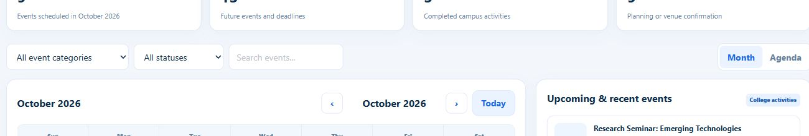

# Owner / Admin college calendar

The Owner workspace replaces its Timetable module with Calendar in the same sidebar position. Teaching allocation remains available under Faculty & Staff. The page follows the supplied `VCET_Calendar_Module_edited.html`: month/agenda views, category and status filters, event search, activity counts, event details and schedules. Filters and view buttons retain the document's 14px text and compact padding.

Activities are stored in `campus.calendar.event`, with active-college record rules, admin create/edit access and management read-only access. Personal reminders use Odoo activities. The 17 reference activities load only as demo data, with sample labels and descriptions.

## Verification

- Upgraded `ideastone_erp` and `ideastone_ai` on the existing local Odoo 17 database after rebasing onto current `main`.
- 31 Odoo tests passed across `TestCollegeCalendar`, `TestOwnerMVP`, `TestAcademicsUI` and `TestFacultyHome` (zero failures/errors).
- Repository Ruff checks passed for `addons/` and `scripts/`; all 104 addon XML files parsed; Calendar SCSS compiled; changed JavaScript passed `node --check`.
- Local browser verification covered create/edit/reload persistence, month navigation, a cross-month activity, combined filters, empty search results and Month/Agenda switching.
- Computed desktop filter/control fonts are 14px. Fields use 10px 12px padding; Month/Agenda use 8px 12px padding, matching the original document.
- The existing Owner CI browser script now checks Calendar navigation, typography, create/edit persistence and reminders instead of the retired Owner Timetable module. The complete clean-install and browser suite runs in the PR's CI.



The targeted backend test can be repeated with:

```sh
docker compose exec -T odoo odoo -c /etc/odoo/odoo.conf -d campus \
  --stop-after-init --workers=0 --http-port=18079 --gevent-port=18080 \
  --test-enable --test-tags /ideastone_erp:TestCollegeCalendar
```
