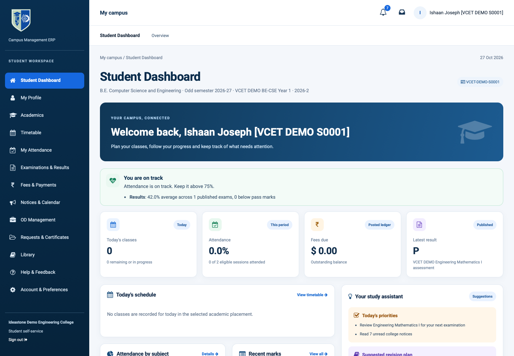

# Campus tabs retained the previous user's workspace

## Confirmed bug

An HOD or faculty workspace stayed open when another tab logged into a Student or Parent account on the same origin. Safari shares that session cookie across its normal tabs. The old screen kept its original role, cached permissions, company context and action hash, while its requests ran as the newly authenticated user.

The local runtime recorded a successful Student sign-in followed by `campus.dashboard/get_overview` from the old staff screen. The server correctly rejected it with `Campus overview requires an internal staff account`; the component replaced this with the generic Retry message. Retrying could not restore the previous login.

## Fix

One session service is included in both the staff backend and campus portal assets. A cross-tab storage event prompts an authenticated check against Odoo's existing session endpoint. Focus, visibility changes and restored pages provide a fallback. Failed model RPCs also trigger the check. Concurrent events share one request; there is no polling or extra request on each normal module click.

If the server reports a different account or database, the page navigates to the current account's staff or portal landing page, dropping the previous action hash and company context. An expired session goes to sign-in. A temporary connection failure retains the current page. The storage value contains only a user-ID hint and cannot authenticate a user or bypass backend permissions.

## Validation — 27 October 2026

- Seven Node scenario tests passed: same account, staff/portal transitions, database change, expiry versus network failure, concurrent events, and untrusted storage hints.
- Six real two-tab scenarios passed in Chromium and WebKit: same-account module navigation, background staff → portal, portal → another portal account at the same URL, portal → staff, logout, and focus detection without a storage announcement.
- Both browser runs reported zero JavaScript page errors. The staff tab that previously displayed Retry rendered the active Student dashboard.
- The existing `campus_latest` synthetic dataset was preserved. Browser checks only authenticated and read existing records.
- CI runs the Node scenarios and repeats the Chromium scenarios after its disposable Parent Portal fixture is ready. Passwords come from runtime environment variables and are not saved in this report or evidence.

Results: [WebKit](evidence/webkit-results.json), [Chromium](evidence/chromium-results.json).

## Use and limits

Reload existing tabs once to load the new asset. One ordinary browser profile still has one active login per site. Use separate browser profiles when demonstrating different roles simultaneously. The WebKit check validates Safari's browser engine; the installed Safari app was not automated. Production and external SSO were not exercised.
